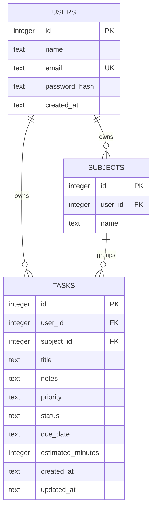

# Database schema and sample data

SQLite 3 is included in Python; no database server or credentials are needed.

- `schema.sql`: users, subjects, tasks, ownership constraints, and indexes.
- `sample_data.sql`: a fictional demo account, three subjects, and five tasks.
- `database.sql`: combined schema and seed, generated by `scripts/package_deliverables.py`.

From the repository root, initialize the application database:

```sh
cd "Functional Web Application"
python -m flask --app run init-db --demo
```

Alternatively run `sqlite3 study.sqlite3 < database.sql` with the optional SQLite CLI.
The application uses `Functional Web Application/instance/study.sqlite3` by default.
Run the combined script against that path if you want the app to read the imported data.

The demo login is `demo@example.com` / `StudyDemo!2026`. Seed deadlines are relative
to the machine's local date at import. Re-running the scripts preserves existing
records; use a fresh database to regenerate relative deadlines.

## Relationships



Subject names are unique per user, ignoring case. A composite foreign key from
tasks to `(subjects.id, subjects.user_id)` prevents linking another user's subject.
A subject with tasks cannot be deleted; move or remove its tasks first.
The API checks real calendar dates in addition to the SQL date format constraint.
Foreign keys must be enabled for every SQLite connection; the app does this automatically.
